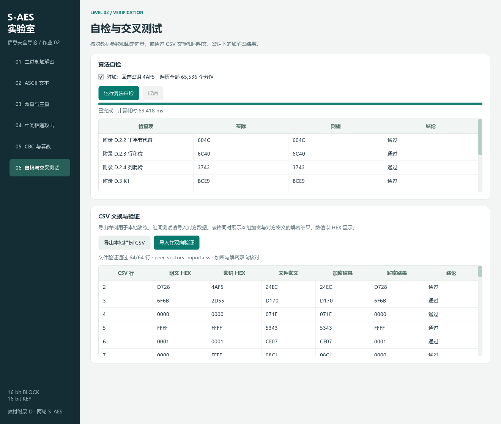

# 第 2 关：组间交叉验证报告

2026-10-24，本组使用另一组提供的 [S-AES-cross-test-20261024.zip](evidence/cross-test/S-AES-cross-test-20261024.zip)，在 S-AES 实验室 **1.1.0** 中完成交叉验证。基础 64 组数据的加密、解密均一致，完整数据包的 **119 个用例、220 行结果全部 PASS**。

本次实验以对方给定的输入和期望输出为基准，分别核对本组的加密、解密、密钥扩展和扩展功能，验证两组实现对同一数据的计算结果是否一致。

## 1. 来源与完整性

| 项目 | 实测记录 |
|---|---|
| 数据来源 | 另一组提供的 S-AES 交叉测试数据包 |
| 原包保存 | `docs/evidence/cross-test/S-AES-cross-test-20261024.zip` |
| 原始文件保存 | 完整 ZIP 含 14 个原始文件；算法输入与清单保存在 `peer-original/` |
| 清单核验 | manifest 中 13 个文件的 SHA-256 全部一致 |
| 程序 | S-AES 实验室 1.1.0 |
| 软件环境 | CPython 3.13.7，PySide6 / Qt 6.11.1，Windows 11 |
| 实测日期 | 2026-10-24 |
| 总计算耗时 | 0.4735219 秒，含两次完整 MITM，另一次 GUI 运行单独计时 |

原 ZIP 的 SHA-256：

```text
b57ef988afaa6f38a4e14fefb01ab25917646be177980e7019e2cff2fe60209d
```

本组将对方的说明、原始结果表和自检记录保留在完整 ZIP 中，所有源文件均按原字节保存。正式实验结果为本组运行后填写的 [cross-test-results.csv](evidence/cross-test/cross-test-results.csv)，包含每一项期望值、实际值、通过状态和运行说明。

## 2. 参数与格式对齐

双方使用 16 位分组、16 位单密钥，大端字节顺序，状态为 `[n0 n2; n1 n3]`；S 盒、逆盒、GF 模 `x^4+x+1`、列矩阵 `[1 4;4 1]`、逆矩阵 `[9 2;2 9]` 及 RCON `80,30` 一致。

扩展约定亦一致：双重 EE；三重 48 位 EEE；消息无填充或两字节 PKCS#7；CBC 使用单次 S-AES 和给定 IV。因此全部用例可以实际执行，没有 N/A。

基础原始 CSV 有 11 列，本界面使用三列。适配后的 [peer-vectors-import.csv](evidence/cross-test/peer-vectors-import.csv) 仅抽取并重命名明文、密钥、密文列，不重新生成密文，保留 16 位位串、前导零和全部 64 行顺序。原包 CSV 和 GUI JSON 中对应字段逐一核对一致。

篡改数据从 1 开始编号，而本组接口从 0 开始；验证适配时仅把分组序号减 1，比特 0 仍表示最低位。原数据文件不作修改。

## 3. 基础双向验证

每组计算本组 `E_K(P)` 并与对方密文 C 比较，再直接计算 `D_K(C)` 检查是否恢复 P；另外核对 K0/K1/K2 与本组独立矩阵参考实现。

| 检查项目 | 实测结果 |
|---|---|
| 原始 CSV 与 JSON 的位串对应 | 64/64 |
| 本组加密等于对方密文 | 64/64 |
| 直接解密对方密文恢复原明文 | 64/64 |
| 三轮密钥相同 | 64/64 |
| 本组独立矩阵参考加密一致 | 64/64 |
| 实际 Qt 按钮导入及两列显示核对 | 64/64 |

样本包含 43 种明文、43 个密钥，覆盖标准例、全零、全一、前导零、各位单独置位及固定种子随机数据。下表摘录首尾数据，全部逐行结果见 [basic-cross-results.csv](evidence/cross-test/basic-cross-results.csv)。

| ID | 明文 HEX | 密钥 HEX | 对方密文 | 本组加密 | 本组解密 |
|---|---|---|---|---|---|
| B001 | D728 | 4AF5 | 24EC | 24EC | D728 |
| B002 | 6F6B | 2D55 | D170 | D170 | 6F6B |
| B003 | 0000 | 0000 | 071E | 071E | 0000 |
| B004 | FFFF | FFFF | 5343 | 5343 | FFFF |
| B005 | 0001 | 0001 | CE07 | CE07 | 0001 |
| B063 | 1CD8 | 12BD | 8CAB | 8CAB | 1CD8 |
| B064 | CE65 | 6399 | B2B6 | B2B6 | CE65 |

## 4. 全部功能的交叉结果

| 类别 | 用例数 | 模板结果行 | PASS | 验证内容 |
|---|---|---|---|---|
| basic | 64 | 128 | 128 | 分组加密与直接解密对方密文 |
| ascii | 12 | 24 | 24 | 空串、奇偶长度、控制字符、全部 ASCII、单双三重消息 |
| double | 8 | 16 | 16 | 32 位双重 EE，两方向及各级状态 |
| triple48 | 8 | 16 | 16 | 48 位三重 EEE，两方向及各级状态 |
| mitm | 2 | 2 | 2 | 完整密钥空间、候选数量及完整集合 SHA-256 |
| cbc | 9 | 18 | 18 | 长消息、不同 IV、重复分组、填充和字节序 |
| tamper | 6 | 6 | 6 | 翻转、替换、IV 变化、末块与填充破坏 |
| invalid | 10 | 10 | 10 | 非法位宽、字符、密钥、IV、奇数字节和空攻击输入 |
| 合计 | 119 | 220 | 220 | 全部执行并通过 |

本组通过现有分组接口复合 ASCII 双重及三重消息，填充只在最外层处理一次。空明文的解密实际值为空，对应结果行记录为 PASS，保证空消息也纳入验证。

### 中间相遇完整集合

| ID | 已知对 | 枚举数 | 候选数 | 正确密钥 | 计算耗时 / ms |
|---|---|---|---|---|---|
| M001 | D728→73A7 | 131072 | 66009 | 含 1234ABCD | 185.3524 |
| M002 | 再加 0000→B50E、FFFF→4089 | 131072 | 1 | 唯一 1234ABCD | 238.9725 |

全部候选按 `(K1,K2)` 排序，每行 8 位大写 HEX 加 LF，按 ASCII 计算散列；两组散列与他组完全一致：

```text
M001 a4b24ca20a14ce63a50c4c39126fd99da5170735bdf4cf1de3cd5bc5dcd2372c
M002 c8d34d579a1be7a4383047b1218842a680345ef78db0d8fdac7e522622d5775d
```

[M001 全部候选](evidence/cross-test/M001-candidates.txt)和 [M002 唯一候选](evidence/cross-test/M002-candidates.txt)可直接重新计算散列，避免仅凭候选数量判断一致。

### CBC 篡改

6 组均核对未去填充的原始明文字节、逐分组 XOR、受影响分组及填充状态。X001 将首个密文 1515 改为 1514，原明文 `4142434445464748` 变为 `6149434545464748`；X005 仅将 IV 从 CAFE 改为 CAFF，只有第一个明文分组精确翻转最低位；X006 原始解密为 `61490203`，PKCS#7 不合法，与对方预期一致。详细分组见 [cross-test-details.json](evidence/cross-test/cross-test-details.json)。

## 5. 界面证据

通过真实 Qt“导入并双向验证”按钮选择适配 CSV，页面显示 64/64 通过。两张 1320×1120 完整窗口截图分别展示表格首部与末部；界面表格可滚动，完整数据以 CSV 为准。




[ui-evidence.json](evidence/cross-test/ui-evidence.json)记录实际导入后全部 64 行的加密与解密列校验，截图未拼接或替换数值。

## 6. 复现

在项目根目录执行：

```powershell
# 他组数据全部验证并回填模板
.\.venv\Scripts\python.exe tools/verify_cross_test.py

# 完整 56 项自动测试以及本地、他组实验材料
.\.venv\Scripts\python.exe tools/verify_project.py

# 更新本地交换与他组首尾界面截图
.\.venv\Scripts\python.exe tools/capture_screenshots.py --peer-only

# 文档链接、来源哈希、候选集合及结果完整性
.\.venv\Scripts\python.exe tools/check_deliverables.py
```

结论：本组程序与另一组给定的 64 组基础向量和全部扩展测试结果一致，第 2 关交叉测试完成。来源原包、原始清单、220 行实际结果、完整 MITM 候选、界面截图及复现脚本共同构成本次记录。
