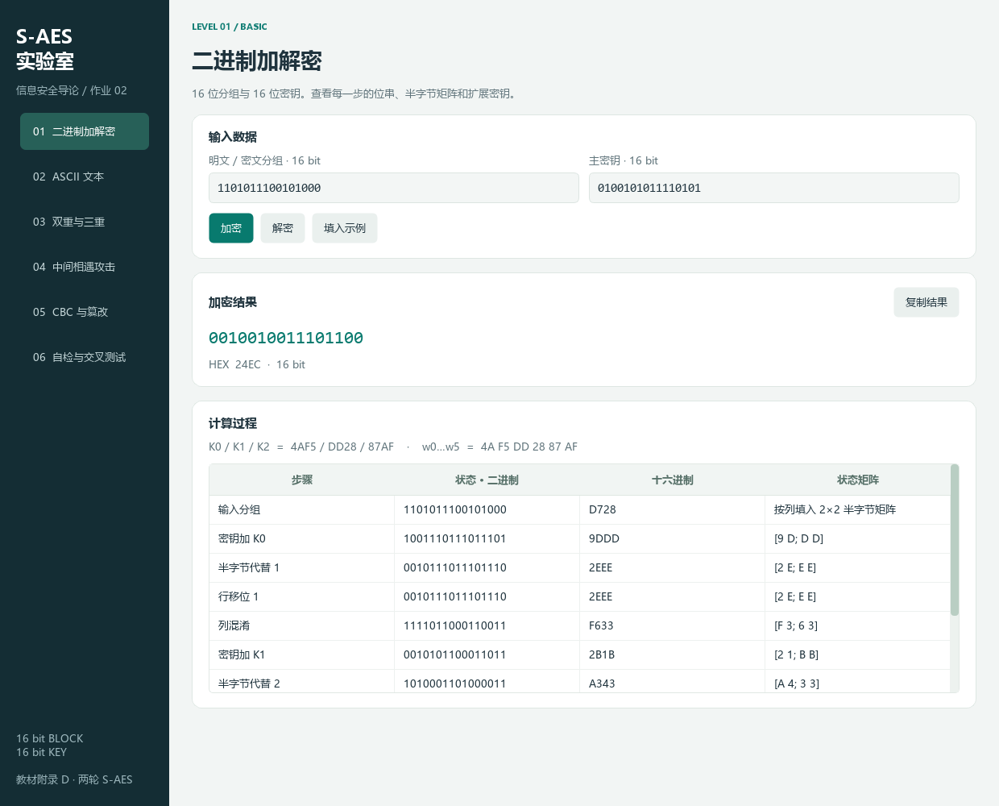
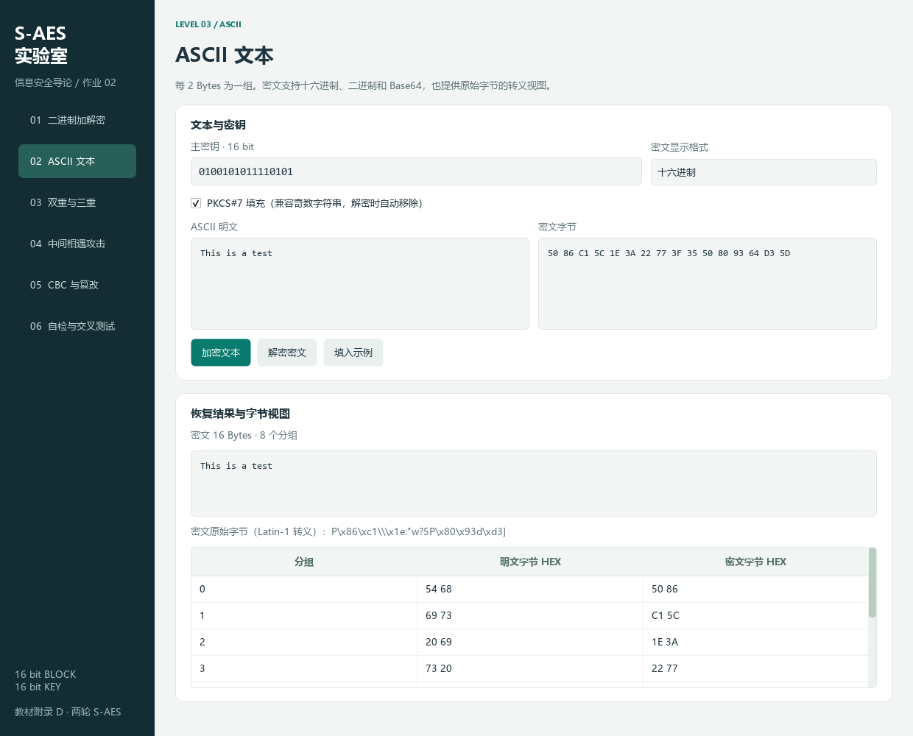
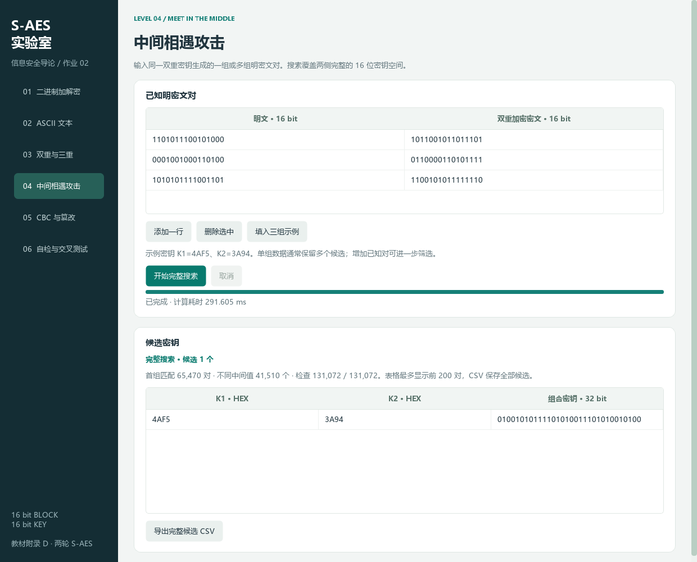
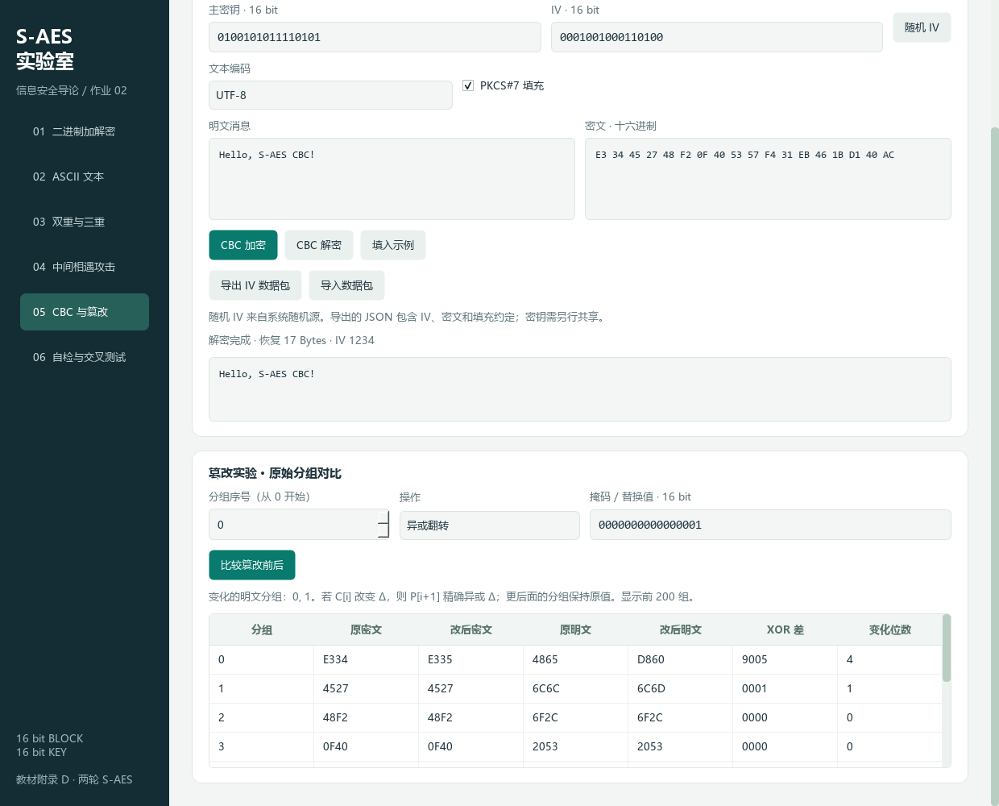

# 信息安全导论作业 2：S-AES 五关测试报告

本组于 2026-10-24 使用程序 1.1.0 完成五个关卡的实验与验证。其中，第 2 关采用另一组提供的原始数据包，119 个用例对应的 220 行交叉结果全部通过。

## 1. 环境与证据

| 项目 | 实测值 |
|---|---|
| 系统 | Windows 11，10.0.26100 |
| Python | CPython 3.13.7，项目独立 `.venv` |
| GUI | PySide6 / Qt 6.11.1 |
| 测试数量 | 56 项，失败 0，错误 0，跳过 0 |
| 测试计算耗时 | 5.4126596 秒 |
| 他组交叉结果 | 119 个用例，220 行 PASS，失败 0 |
| 截图 | 真实 Qt 控件，离屏抓取窗口 |
| 布局检查 | 1240×1000、960×640，另检查 150% / 200% 缩放 |

本组将原始记录保存在 [unittest.txt](evidence/results/unittest.txt) 和 [summary.json](evidence/results/summary.json) 中。本文采用本次实验的实测数据。脚本与界面分别计时，运行环境和缓存状态会影响耗时，密文、候选集合与验证结论保持一致。

测试由 12 项核心测试、24 项服务测试、6 项他组数据回归测试、14 项 GUI 测试组成。独立参考实现从 GF 求逆与仿射变换生成 S 盒，采用独立多项式和矩阵运算，避免仅靠自身加解密往返判定正确。

## 2. 第 1 关：基本测试

### 教材参数与中间状态

输入 `A749`，密钥 `2D55`，按附录 D 的状态顺序计算：

| 步骤 | 实测 HEX |
|---|---|
| 输入 | A749 |
| 密钥加 K0 | 8A1C |
| 半字节代替 1 | 604C |
| 行移位 1 | 6C40 |
| 列混淆 | 3743 |
| 密钥加 K1 | 8BAA |
| 半字节代替 2 | 6300 |
| 行移位 2 | 6003 |
| 密钥加 K2 / 密文 | C349 |

扩展字为 `2D 55 BC E9 A3 4A`，轮密钥为 `2D55 / BCE9 / A34A`。前四步变换与附录例子直接对应，完整结果另由独立参考实现核对。见[过程 JSON](evidence/results/binary-trace.json)。

默认固定向量 `D728 / 4AF5 → 24EC` 的轮密钥为 `4AF5 / DD28 / 87AF`，状态为 `D728 → 9DDD → 2EEE → 2EEE → F633 → 2B1B → A343 → A343 → 24EC`。直接解密固定密文可恢复明文。

### 覆盖范围

| 验证 | 覆盖 |
|---|---|
| GF 乘积对照独立多项式实现 | 16×16=256 对 |
| 全状态代替逆变换及行移位逆变换 | 65,536 个状态 |
| 列混淆与逆列混淆 | 每列全部 256 种值，两列分别验证 |
| 固定密钥 4AF5 的全分组往返、密文唯一性 | 65,536 个分组，65,536 个不同密文 |
| 固定分组 D728 的全密钥往返 | 65,536 个密钥 |
| 独立矩阵实现与本组加密实现比较 | 4,096 组确定性样本 |
| 逐轮实现与优化查表实现比较 | 256 组加密与对应解密 |
| 输入验证 | 全零、全一、前导零、越界、bool、浮点数、字符串等 |

上述两项全枚举分别固定一端，未穷举全部 2^32 个明文与密钥组合。独立参考比较亦为选定样本。结果全部一致，第 1 关通过。



## 3. 第 2 关：交叉测试

本组使用另一组提供的 [S-AES-cross-test-20261024.zip](evidence/cross-test/S-AES-cross-test-20261024.zip)。完整 ZIP 保留 14 个原始文件，清单中 13 个文件的哈希全部一致。原始 CSV 与 JSON 的 64 组基础向量包含 43 种明文、43 个密钥，本组加密、直接解密对方密文、三轮密钥和独立参考加密均 64/64 一致。

| 类别 | 用例数 | 实际结果行 | 通过 |
|---|---|---|---|
| 基础加解密 | 64 | 128 | 128 |
| ASCII | 12 | 24 | 24 |
| 双重 EE | 8 | 16 | 16 |
| 48 位三重 EEE | 8 | 16 | 16 |
| 中间相遇 | 2 | 2 | 2 |
| CBC | 9 | 18 | 18 |
| 篡改 | 6 | 6 | 6 |
| 非法输入 | 10 | 10 | 10 |
| 合计 | 119 | 220 | 220 |

他组单对 MITM 数据得到 66,009 个候选，三对数据仅剩 1234ABCD；完整集合 SHA-256 与对方预期相同。6 组篡改核对原始字节、逐块差异及填充状态；10 组非法输入均由本组对应接口拒绝。

本组在 CSV 适配中保留了原始位串、行顺序和期望结果；220 行结果的 expected 列与原表一致，actual、status、note 记录本组实际计算值。GUI 通过导入按钮读取 64 行，分别展示本组加密与解密恢复。本次实验验证了本组实现与对方给定向量的一致性。

原始输入与全部输出见[交叉报告](cross-test-record.md)、[回填结果 CSV](evidence/cross-test/cross-test-results.csv)、[统计 JSON](evidence/cross-test/cross-test-summary.json)。第 2 关通过。本地 8 条样例仍单独保留为交换工具自测。


## 4. 第 3 关：ASCII 扩展

| 项目 | 实测结果 |
|---|---|
| 明文 | `This is a test`，14 Bytes |
| 密钥 | 4AF5 |
| 填充 | PKCS#7，末尾 `02 02` |
| 密文 HEX | `50 86 C1 5C 1E 3A 22 77 3F 35 50 80 93 64 D3 5D` |
| Base64 | `UIbBXB46Inc/NVCAk2TTXQ==` |
| 恢复 | 与原文一致 |

测试覆盖空文本、奇偶长度、全部 128 种 ASCII 字符、NUL / DEL / 换行 / 制表符、末尾零字节和类填充字节；原始 bytes 接口验证全部 256 个字节的往返。HEX、二进制与 Base64 无损转换全部通过，非规范 Base64 填充位也会被拒绝。

关闭填充时只接受偶数字节，不默默补零；错误密钥导致的非 ASCII 结果或非法填充会提示。数据见 [ascii.json](evidence/results/ascii.json)。第 3 关通过。



## 5. 第 4 关：多重加密

### 双重与三重

明文均为 D728，按高位到低位切分密钥。

| 模式 | 组合密钥 HEX | 中间顺序 | 密文 | 解密 |
|---|---|---|---|---|
| 双重 EE | 4AF53A94 | E(4AF5) → E(3A94) | B2DD | D728 |
| 32 位三重 EEE | 4AF53A94 | E(4AF5) → E(3A94) → E(4AF5) | CE12 | D728 |
| 48 位三重 EEE | 4AF53A941234 | E(4AF5) → E(3A94) → E(1234) | 52E2 | D728 |

程序结果与逐次调用单分组加密的显式复合一致，反序解密恢复。边界密钥、全零 / 全一分组和不合法模式 / 宽度均覆盖。作业三重模式任选其一，本项目两种均完成。[完整结果](evidence/results/multiple.json)。

### 中间相遇

已知密钥 K1=4AF5、K2=3A94，生成三组已知对 `D728→B2DD`、`1234→61AF`、`ABCD→CAFE`。每次建立完整正向多值表并完整枚举反向密钥，额外已知对用于筛选。

| 已知对数量 | 枚举密钥数 | 首组匹配数 | 最终候选数 | 计算耗时 / ms |
|---|---|---|---|---|
| 1 | 131,072 | 65,470 | 65,470 | 192.9641 |
| 2 | 131,072 | 65,470 | 1 | 223.2751 |
| 3 | 131,072 | 65,470 | 1 | 219.2020 |

正向中间值有 41,510 种；碰撞桶中的所有 K1 均被保存。三次运行都包含原组合，后两次仅剩 `(4AF5,3A94)`。完整候选列表见 [1 对候选](evidence/results/mitm-candidates-1.csv)、[2 对候选](evidence/results/mitm-candidates-2.csv)、[3 对候选](evidence/results/mitm-candidates-3.csv)，汇总见 [mitm.json](evidence/results/mitm.json)。

本组还测试了相同明文对应矛盾密文、任务启动前取消、建表阶段取消、反向匹配阶段取消，以及碰撞桶中全部候选的保留。取消后记录实际检查数量和对应候选范围。实验说明，候选是否唯一取决于已知数据提供的约束。

第 4 关的双重、攻击和两种三重模式均通过。



## 6. 第 5 关：CBC

### 长消息与 IV

输入 `Hello, S-AES CBC!`（17 Bytes），密钥 4AF5，IV=1234，开启 PKCS#7。加密为 18 Bytes：

```text
E3 34 45 27 48 F2 0F 40 53 57 F4 31 EB 46 1B D1 40 AC
```

直接解密并移除末尾 `01`，恢复完整原消息。随机 IV 接口检查 16 位范围；共享数据包往返保留密文、IV 与填充约定，不携带密钥。见 [cbc.json](evidence/results/cbc.json) 和[可导入数据包](evidence/results/cbc-packet.json)。

### 密文修改

对第 0 个密文分组异或 0001：

| 分组 | 原 C | 改后 C | 原 P | 改后 P | XOR 差 | 变化位数 |
|---|---|---|---|---|---|---|
| 0 | E334 | E335 | 4865 | D860 | 9005 | 4 |
| 1 | 4527 | 4527 | 6C6C | 6C6D | 0001 | 1 |
| 2 | 48F2 | 48F2 | 6F2C | 6F2C | 0000 | 0 |
| 3～8 | 不变 | 不变 | 不变 | 不变 | 0000 | 0 |

符合 CBC 关系：`P'[i+1] XOR P[i+1] = C'[i] XOR C[i]`。本分组解密发生变化，下一分组按 Δ 精确翻转，更后面的分组恢复不受影响。另测试整组替换、末组篡改、仅改变 IV，均符合对应传播范围。[逐组 CSV](evidence/results/cbc-tamper.csv)。

bytes CBC 还覆盖 0～64 字节长度和 UTF-8 中文，非法数据包、IV、分组长度及填充被拒绝。篡改比较使用原始分组，填充损坏不阻止观察；普通文本解密依约定执行去填充。CBC 的这种传播特性也说明仅成功解密或填充合法不能证明密文未被修改。

第 5 关通过。



## 7. GUI 与复现

GUI 测试使用真实按钮、键盘、表格和事件循环，覆盖结果复制、输入修改后清除、模式切换、格式转换失败恢复、候选导出、后台任务锁定输入、取消、异常后重启、CSV 本地导入、CBC 数据包导入导出和运行中关闭窗口。通过临时异常钩子确保 Qt 槽函数未处理异常不会被忽略。

本组的回归测试核对了原包字节、manifest、全部 220 行、完整 MITM 集合散列和空明文输出，并验证修改源数据或使用错误计算时会被检出。GUI 测试通过实际按钮导入他组 64 行，核对首尾的加密与解密列。

```powershell
.\.venv\Scripts\python.exe -m unittest discover -v
.\.venv\Scripts\python.exe tools/verify_project.py
.\.venv\Scripts\python.exe tools/verify_cross_test.py
.\.venv\Scripts\python.exe tools/capture_screenshots.py
```

通过本次实验，本组完成了 S-AES 算法、文本扩展、多重加密、攻击分析和 CBC 工作模式的实现。五个关卡均验证通过，56 项自动测试全部成功，他组数据 220 行全部 PASS，基础 GUI 双向显示 64/64 一致。原始数据、程序截图和脚本输出共同支持上述结论。
