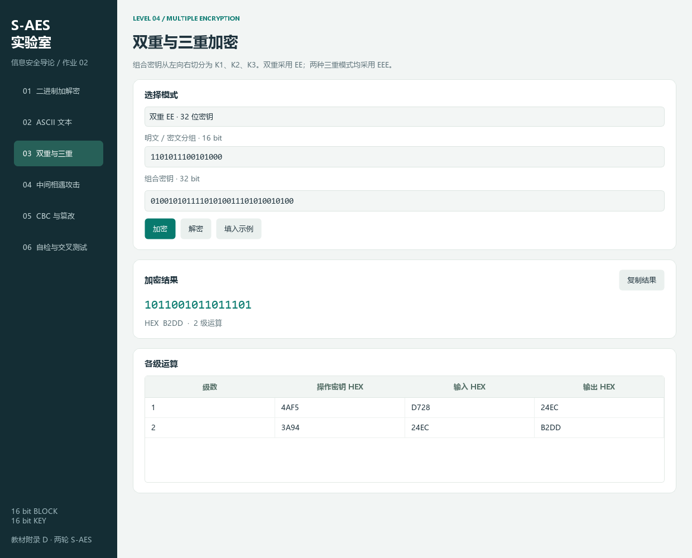
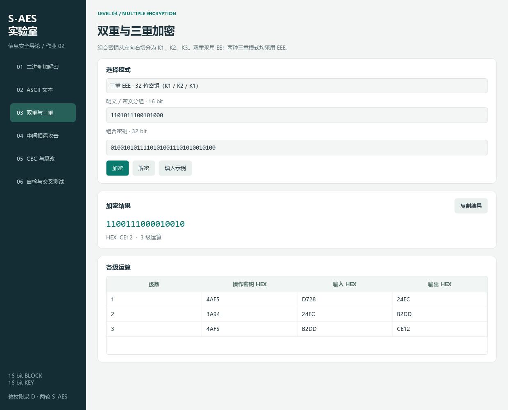
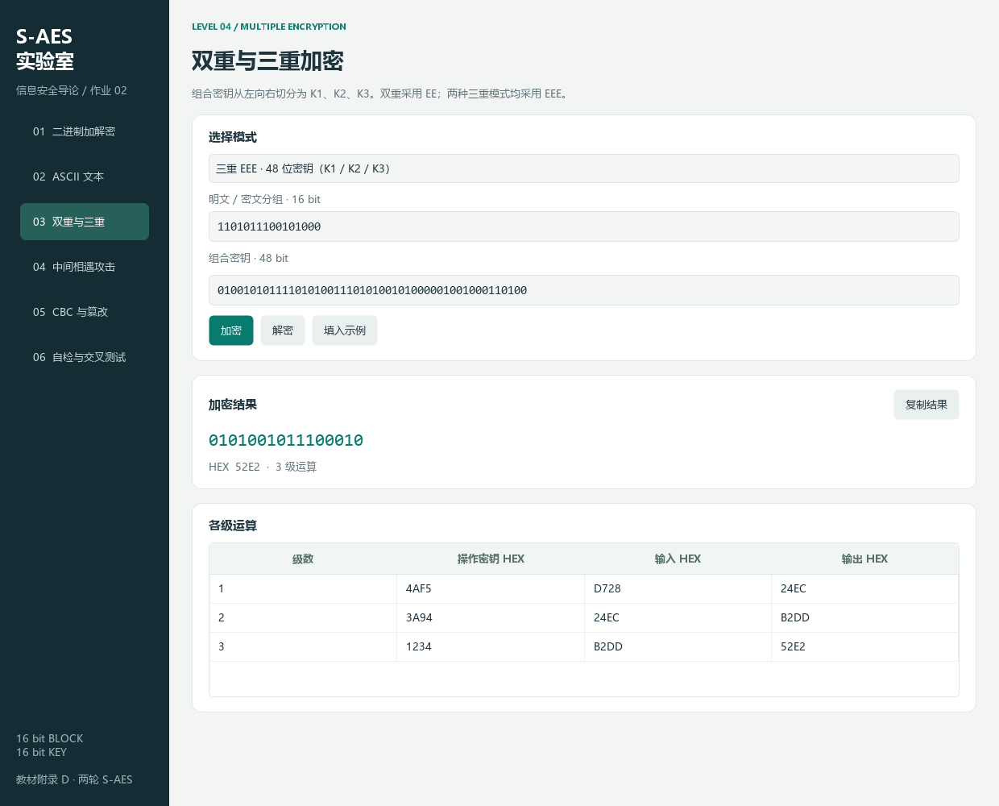

# 第二次作业通关说明

本组使用程序 1.1.0 完成了五关实验。本说明按照作业关卡记录操作步骤和验证结果，可结合程序、截图和测试报告逐项复现。界面左侧的 01～06 是导航序号，下文的第 1～5 关对应课程作业关卡。

## 准备

在项目根目录双击 `启动程序.bat`，或执行：

```powershell
.\.venv\Scripts\python.exe -m saes_app
```

程序标题应为“S-AES 实验室 · 信息安全导论第二次作业”。输入框中的二进制按完整位数输入；本文 HEX 只用于对照，不能直接填入二进制框。

## 第 1 关：基本测试

进入“01 二进制加解密”，点击“填入示例”。

| 项目 | 应出现的值 |
|---|---|
| 16 位明文 | `1101011100101000` |
| 16 位密钥 | `0100101011110101` |
| 加密密文 | `0010010011101100`，HEX `24EC` |
| K0 / K1 / K2 | `4AF5 / DD28 / 87AF` |

1. 点击“复制结果”。
2. 用密文替换输入分组，保持密钥不变，点击“解密”。
3. 解密结果应为 `1101011100101000`，HEX `D728`。
4. 滚动“计算过程”表，检查轮状态与[测试报告](test-report.md)一致。
5. 将密钥改成 `1`，点击“加密”，应提示需要恰好 16 位，旧结果不再保留。

教材示例的另一组输入为：明文 `1010011101001001`（A749），密钥 `0010110101010101`（2D55），加密结果应为 `1100001101001001`（C349）；第一轮中间状态依次包含 `8A1C → 604C → 6C40 → 3743`。


**本关结论：** 基本加解密、输入校验与教材变换核对已通过。

## 第 2 关：交叉测试

本组将他组原包保存在 `docs/evidence/cross-test/S-AES-cross-test-20261024.zip`，算法输入和清单位于 `peer-original/`。实验直接使用对方提供的数据，正式结果记录本组的实际计算值。

1. 进入“06 自检与交叉测试”，点击“导入并双向验证”。
2. 选择 `docs/evidence/cross-test/peer-vectors-import.csv`。这是他组原始 64 组数据的三列格式适配，位串和顺序均不变。
3. 确认“文件验证通过 64/64 行”。表格使用 HEX，分别比较文件密文、本组加密结果、本组解密恢复。
4. 第一条应为明文 D728、密钥 4AF5、文件 / 本组密文 24EC、恢复明文 D728。
5. 滚动到最后一条，应为明文 CE65、密钥 6399、文件 / 本组密文 B2B6、恢复明文 CE65。
6. 执行完整数据包脚本，查看 119 个用例、220 行均 PASS：

```powershell
.\.venv\Scripts\python.exe tools/verify_cross_test.py
```

基础、ASCII、双重、48 位三重、CBC、篡改和非法输入的结果全部一致；他组单对 MITM 得到 66,009 个候选，三对后唯一候选为 `1234ABCD`，完整集合散列也一致。本组实际结果保存在 `cross-test-results.csv`，对方原始结果表按原字节归档在 ZIP 中。


**本关结论：** 他组基础数据双向 64/64 通过，完整扩展数据 220/220 通过。详情见[交叉测试报告](cross-test-record.md)。

## 第 3 关：ASCII 扩展

进入“02 ASCII 文本”，点击“填入示例”，默认开启 PKCS#7 填充。

| 项目 | 应出现的值 |
|---|---|
| 明文 | `This is a test` |
| 密钥 | `0100101011110101` |
| 密文 HEX | `50 86 C1 5C 1E 3A 22 77 3F 35 50 80 93 64 D3 5D` |
| 密文长度 | 16 Bytes，8 个分组 |
| 解密恢复 | `This is a test` |

1. 将显示格式切换成 Base64，应得到 `UIbBXB46Inc/NVCAk2TTXQ==`。
2. 点击“解密密文”，应恢复相同文本。
3. 将明文改成 `A`，保留填充后加解密，应恢复一个字符 `A`。
4. 关闭填充后加密 `A`，应提示原始分组必须为偶数字节。
5. 关闭填充，改为 `AB`，应正常加解密。
6. 输入中文后加密，应提示非 ASCII 字符位置。

若要严格展示无填充的教材式两字节输入，可关闭填充后使用原来 14 字节的示例，此时只有前 14 字节密文，不含末尾 `D3 5D` 填充分组。


**本关结论：** 两字节分组、奇偶长度处理、字节显示和格式转换已通过。

## 第 4 关：多重加密与中间相遇

### 4.1 双重加密

进入“03 双重与三重”，选择“双重 EE · 32 位密钥”，点击“填入示例”。

```text
明文：1101011100101000
密钥：01001010111101010011101010010100
密文：1011001011011101
```

应显示 `D728 →(K1=4AF5) 24EC →(K2=3A94) B2DD`。将该密文填回分组框并点击“解密”，应恢复 D728。



### 4.2 中间相遇攻击

进入“04 中间相遇攻击”，点击“填入三组示例”。

| 行 | 明文二进制 | 双重密文二进制 | HEX 对照 |
|---|---|---|---|
| 1 | `1101011100101000` | `1011001011011101` | D728 → B2DD |
| 2 | `0001001000110100` | `0110000110101111` | 1234 → 61AF |
| 3 | `1010101111001101` | `1100101011111110` | ABCD → CAFE |

1. 保留三行，点击“开始完整搜索”。应显示完成、检查 `131072 / 131072`，唯一候选 K1=`4AF5`、K2=`3A94`。
2. 点击“导出完整候选 CSV”，确认保存的完成状态为 True。
3. 删除第 2、3 行，只保留首行后重新搜索，应有 **65,470** 个候选。表格只展示前 200 对，完整 CSV 含全部候选。
4. 增加第二组明密文对重新搜索，当前示例应缩小为 **1** 个候选。
5. 在搜索过程中点击“取消”，可观察已检查数量和部分候选；计算结束后，界面显示完整结果和实际耗时。

搜索分别完整枚举 K1、K2 的 16 位空间，没有枚举全部 2^32 组合；通过中间状态表减少重复计算。碰撞桶中的 K1 全部保留，因此不会遗漏同一中间值的其他候选。


### 4.3 三重加密

作业要求 32 位或 48 位任选一种，本项目两种均可演示。保持明文 D728，每次切换模式后点击“填入示例”。

| 模式 | 组合密钥 HEX | 加密顺序 | 预期密文 HEX / 二进制 |
|---|---|---|---|
| 32 位三重 | `4AF53A94` | K1 → K2 → K1 | `CE12` / `1100111000010010` |
| 48 位三重 | `4AF53A941234` | K1 → K2 → K3 | `52E2` / `0101001011100010` |

48 位二进制密钥为：

```text
010010101111010100111010100101000001001000110100
```

两种模式分别把密文填回分组框并点击“解密”，均应恢复 D728。三重采用 EEE，各级输出显示在表格中。





**本关结论：** 双重 EE、完整中间相遇搜索和两种三重 EEE 均已通过。

## 第 5 关：CBC 与篡改

进入“05 CBC 与篡改”，点击“填入示例”，应自动完成三个操作。

| 项目 | 应出现的值 |
|---|---|
| 明文 | `Hello, S-AES CBC!` |
| 密钥 | `0100101011110101`（4AF5） |
| IV | `0001001000110100`（1234） |
| 编码与填充 | UTF-8，开启 PKCS#7 |
| 密文 HEX | `E3 34 45 27 48 F2 0F 40 53 57 F4 31 EB 46 1B D1 40 AC` |
| 解密恢复 | `Hello, S-AES CBC!` |

共享演示：点击“导出 IV 数据包”，保存 JSON；清空密文并改变 IV 后，导入同一文件，确认 IV 恢复 1234，密文恢复上述值；输入相同密钥，点击“CBC 解密”应恢复原消息。另点击“随机 IV”可观察系统生成的 16 位随机值；此后应重新加密得到与该 IV 配套的密文。

篡改演示：在下方选择序号 0、“异或翻转”、掩码 `0000000000000001`，点击“比较篡改前后”。

| 分组 | 原密文 → 改后密文 | 原明文 → 改后明文 | XOR 差 / 改变位数 |
|---|---|---|---|
| 0 | E334 → E335 | 4865 → D860 | 9005 / 4 |
| 1 | 4527 → 4527 | 6C6C → 6C6D | 0001 / 1 |
| 2 | 48F2 → 48F2 | 6F2C → 6F2C | 0000 / 0 |
| 3～8 | 不变 | 不变 | 0000 / 0 |

再选择“整组替换”、值全零，可观察替换影响；把序号改成最后一组，仅该组明文改变。比较表使用原始分组，不会因填充字节损坏而中断；普通解密仍按填充约定校验。


**本关结论：** CBC 长消息、IV 生成与共享、密文翻转与替换对比已通过。

## 最后核验

运行完整测试：

```powershell
.\.venv\Scripts\python.exe -m unittest discover -v
```

本组运行结果为 56 项测试全部成功，失败和错误均为 0；他组交叉结果的 220 行均为 PASS。原始实验结果见[材料索引](evidence/README.md)，各关数据与分析见[五关报告](test-report.md)。
